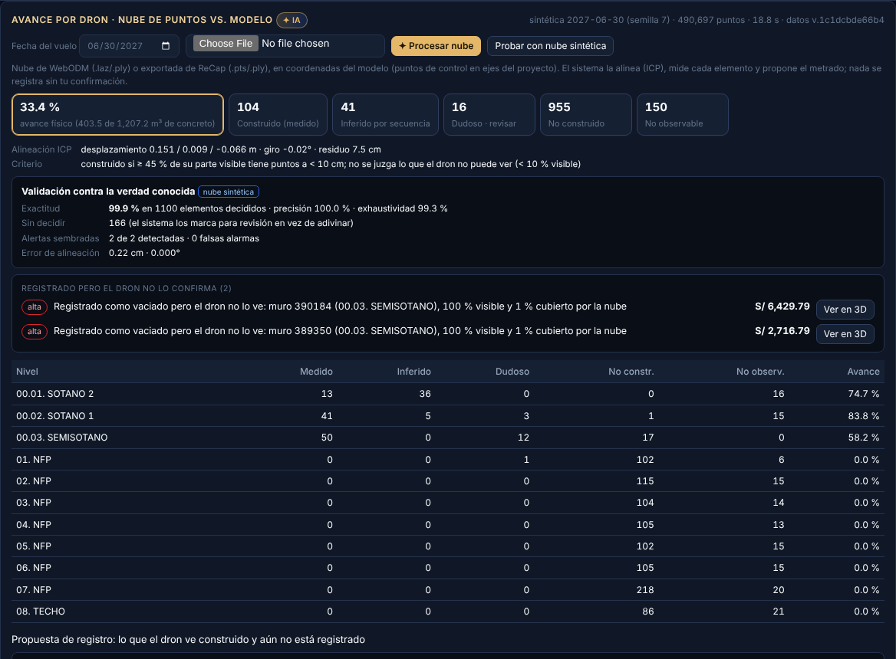
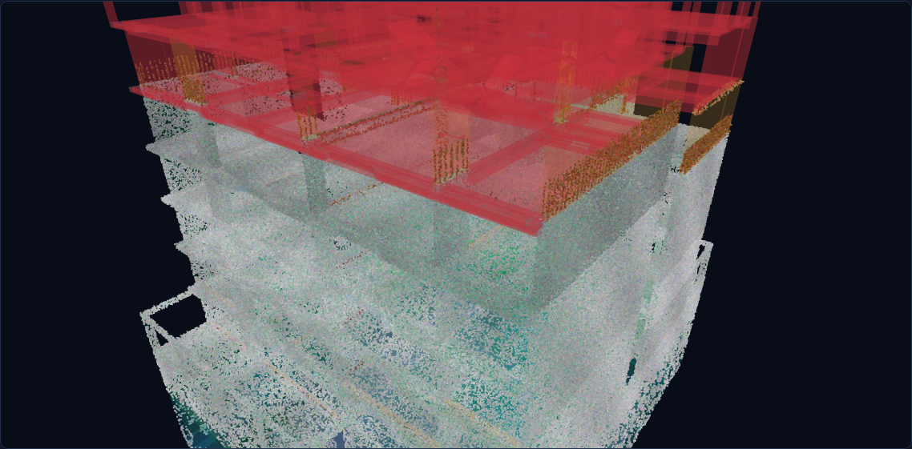

# NEXO OBRA · capa de IA (Reto 3 · Hackathon BIM + IA UNSA 2026)

IA integrada **dentro** del panel de valorizaciones NEXO OBRA, sin Revit y sin tocar el repo `BIM-IA`.
Soporta **varias obras y versiones de modelo**, y se puede publicar como link (PC y celular).

## Arrancar (Mac / Linux / Windows)

```bash
# carpetas lado a lado:  ./BIM-IA  (repo del equipo)   ./nexo-ia  (esta carpeta)
cd nexo-ia
pip3 install -r requirements.txt
python3 servidor.py                      # → http://127.0.0.1:8770
python3 pruebas/test_ia.py               # 10 pruebas (usa carpetas temporales)
python3 pruebas/evaluar_parte_diario.py  # precisión del parte diario asistido
```
Si el repo está en otra ruta: `NEXO_REPO=/ruta/a/BIM-IA python3 servidor.py`. Para reiniciar la demo: borrar `estado/`.

## Dónde vive cada cosa

| Qué | Dónde | Quién escribe |
|---|---|---|
| Código del panel y scripts | repo `BIM-IA` (git) | programadores |
| **Versiones publicadas del modelo** (inmutables) | `modelos/<obra>/<version>/` + `modelo.json` | modelador, con «Publicar» |
| **Estado de obra**: registros de metrado, decisiones, bitácora IA, caché | `estado/<obra>/` | el panel (residentes, costos) |
| El modelo `.rvt` | PC del modelador | Revit |

El repo se lee en solo lectura y además se registra como una obra más (`REP0-MOD2`, versión `R02`).

## Publicar una versión nueva del modelo (sin cambiar el complemento)

1. El modelador exporta desde Revit como hoy (NexoMetrados + instantánea).
2. Empaqueta: `python3 empaquetar_version.py --repo ../BIM-IA --rvt REP0-MOD2-R03 --id REP0-MOD2 --version R03 --autor "Ana" --comentario "placas eje 3"`
3. Publica:  `curl -X POST --data-binary @REP0-MOD2_R03.zip -H "X-Nexo-Admin: $NEXO_TOKEN_ADMIN" https://<servidor>/api/admin/publicar`
   (o copiar la carpeta descomprimida a `modelos/REP0-MOD2/R03/`).

La versión aparece en el selector **Modelo / Versión** de la cabecera. La más reciente es la vigente.
Una versión no se puede sobrescribir (→ 409): un cambio en Revit = una versión nueva.
El ML y la auditoría de la versión nueva se calculan en segundo plano al publicar.

## Ir y volver de Revit

- **Revit → panel**: publicar versión (arriba).
- **Panel → Revit**: el avance **no se escribe dentro del .rvt**. Igual que en el complemento original
  (`Escritura.cs`: «nunca en el modelo de Revit»). `GET /api/registros.json` (o Configuración → Trazabilidad →
  «descargar registros») entrega el archivo en el **mismo formato** que `registros_<modelo>.json` del complemento:
  se copia junto a los datos y el complemento NexoObraNO lo lee tal cual.

## Seguridad para el link

| Variable | Efecto |
|---|---|
| `NEXO_TOKEN=…` | Cualquiera con el link **ve**; para registrar o decidir hay que entrar una vez con `/entrar?token=…` (cookie 30 días) |
| `NEXO_TOKEN_ADMIN=…` | Necesario para publicar versiones |
| `NEXO_SOLO_LECTURA=1` | Vitrina: nadie escribe |
| `NEXO_LLM_POR_MINUTO=30` | Límite de llamadas a la IA por IP |
| `NEXO_MODELO_DEFECTO=…` | Obra que ve quien entra sin haber elegido |
Sin `NEXO_TOKEN` (modo local) se puede escribir libremente.

## Deployment (link público)

```bash
docker build -t nexo-ia .
docker run -p 8770:8770 -v nexo-data:/data -e NEXO_TOKEN=… -e NEXO_TOKEN_ADMIN=… nexo-ia
```
`/data` **tiene que ser un volumen persistente** (versiones publicadas + registros). Proveedores con volumen: Render
(Disk), Fly.io (volumes), Railway (volumes), IBM Code Engine o Cloud Run con almacenamiento montado.
Una instancia atiende bien a 100 usuarios simultáneos (medido: p95 ≈ 1 s en datos y 3D, ≈ 4 s en la auditoría).
Para varias instancias, el estado de obra debe pasar a Postgres/Supabase (`4_Python/supabase_esquema.sql`).

### Activar un LLM (opcional; sin él todo funciona con plantillas verificadas)
```bash
NEXO_LLM=ollama   NEXO_LLM_MODELO=granite3.3:8b python3 servidor.py        # local, sin internet (ollama pull granite3.3:8b)
NEXO_LLM=watsonx  WATSONX_APIKEY=… WATSONX_PROJECT_ID=… python3 servidor.py # IBM Granite en watsonx.ai
NEXO_LLM=openai   OPENAI_API_KEY=… NEXO_LLM_MODELO=gpt-4o-mini python3 servidor.py
NEXO_LLM=anthropic ANTHROPIC_API_KEY=… python3 servidor.py
```

## Las tres capas de IA (la IA nunca produce el número final)

1. **Reglas** (`nexo_ia/auditor.py`), cada hallazgo con fuente, fórmula y valores:
   - R01 solapes de concreto sin unir (97 · S/ 1,232.57)
   - R02 f'c del tipo ≠ material
   - R03 elemento sin material
   - R04 mayor metrado real
   - R04b falsas alarmas por coma flotante del complemento
   - R05 secuencia constructiva
   - R06 P.U. incoherente con el f'c
2. **ML** (`nexo_ia/ml.py`): RandomForest que aprende la geometría de cada grupo sin leer el nombre del tipo.
   Validación cruzada, exactitud 97 %. Se entrena una vez por versión publicada y queda en caché.
3. **LLM** (`narrador.py`, `parte_diario.py`):
   - Solo redacta o interpreta. Salida JSON validada con valores de una lista cerrada.
   - `verificador.py` rechaza números que no estén en la evidencia.
   - Una sola llamada aunque 20 usuarios pidan lo mismo. Caché por obra y versión.
   - Todo queda en `estado/<obra>/bitacora_ia.jsonl`.

## Avance por dron (Scan-vs-BIM) · `escaneo.py`, `sintetico.py`, `nube_io.py`





**Visor de la nube** (botón «Ver la nube de puntos en 3D»): los puntos alineados sobre el modelo, que se colorea por el
estado decidido. Tres modos de color: *color real* de las fotos, *distancia al modelo* (verde ≤ 4 cm, ámbar 4–10 cm,
rojo > 10 cm, magenta = fuera del modelo: grúa, terreno, vecinos) y *estado del elemento*. Corte por altura para ver
dentro. Por defecto se ocultan los puntos de entorno (terreno, grúa, vecinos: lo que no cae sobre ningún elemento); la casilla «entorno» los muestra. «Descargar nube alineada (.ply)» la abre en CloudCompare, ReCap o Revit.

Panel → **Parte diario → «Avance por dron»**. Entra la nube de puntos del vuelo (WebODM `.laz/.ply`, ReCap `.pts`) y sale
el estado de **cada elemento del modelo** + la propuesta de metrado, en el mismo formato que el parte diario asistido.

```
nube ─► ICP contra el modelo ─► por elemento: % de su superficie PROPIA con puntos a < 10 cm
     ─► visibilidad: z-buffer desde las cámaras del plan de vuelo, con la NUBE como obstáculo (un piso que no existe no tapa)
     ─► construido · dudoso · no construido · no observable
     ─► secuencia constructiva: lo que soporta algo construido también lo está (inferido); lo embebido sigue a su anfitrión
     ─► visto y sin registrar → PROPUESTA (validar → registrar, nada automático)
        registrado y no visto → ALERTA de valorización (posible cobro sin ejecución)
```
- **Puntos propios**: se descartan las caras en contacto con otro elemento y los sólidos superpuestos del modelo (R01),
  porque el vecino construido las «cubriría» y daría falsos positivos.
- **No adivina**: lo que el dron no puede ver (< 10 % visible) queda *no observable* salvo que la secuencia lo implique.
- Rutas: `POST /api/ia/escaneo/subir?fecha=&nombre=` (cuerpo = archivo), `POST /api/ia/escaneo/demo {fecha, desde_ifc}`,
  `POST /api/ia/escaneo/ifc` (cuerpo = .ifc), `GET /api/ia/escaneo`, `GET /api/ia/escaneo/nube.ply`, `GET /api/ia/escaneo/simulada.ply`.

### IFC del proyecto = georreferencia (`ifc_modelo.py`)
El IFC exportado de Revit (REP04-CIT-XX-XX-M3-E-00001-R02) viene en **coordenadas compartidas** (E ≈ 640 000,
N ≈ 9 500 000), igual que una nube de WebODM georreferenciada; el panel trabaja en coordenadas internas.
Al subir el `.ifc` en la tarjeta (o dejarlo en `3_Modelo_y_parametros/`, se carga solo al arrancar):
- se cruzan los elementos por **Tag = ElementId**: 1266 de 1266, más 492 bovedillas y 197 barras que solo están en el IFC;
- se ajusta la transformación compartidas → modelo (giro en planta + traslación, robusto, por centroides de superficie):
  **giro −15.000°, residuo mediano 0.1 mm**;
- desde entonces, una nube en UTM/compartidas se convierte sola antes del ICP (se avisa en el resultado);
- la nube sintética puede generarse **desde la geometría del IFC y en coordenadas UTM** (tal como sale de WebODM):
  casilla «simular desde el IFC» o `python3 7_Dron/nube_desde_ifc.py --ifc modelo.ifc --fecha 2027-09-30`.

### Validación con verdad conocida (`python3 pruebas/evaluar_escaneo.py`)
Nubes sintéticas generadas desde el propio modelo: construido = lo programado hasta la fecha de corte, menos vaciados
retrasados al azar (y todo lo que se apoya en ellos); 2 registros falsos sembrados. Para que se parezcan a un vuelo real:
color por material (concreto más oscuro si es reciente, suelo, sillar de los vecinos), grúa, andamio, material acopiado,
encofrado, arranques de acero, excavación y medianeras; oclusión desde el plan de vuelo; densidad que cae con la
distancia a la cámara, huecos en manchas, error a lo largo del rayo de la cámara, puntos sueltos en bordes y
desalineación de hasta 30 cm y 0.8°.

| Escenario | Exactitud | Precisión | Exhaustividad | Decididos | Sin decidir | Alertas | Error ICP |
|---|---|---|---|---|---|---|---|
| Fin de mes 3 (sótanos) | 100.0 % | 100.0 % | 100.0 % | 1130 | 136 | 2/2 | 26.1 cm |
| Fin de mes 6 (base) | 99.9 % | 100.0 % | 99.3 % | 1084 | 182 | 2/2 | 0.1 cm |
| Fin de mes 6 · ruido 4 cm, 30 % huecos | 99.9 % | 100.0 % | 99.3 % | 1113 | 153 | 2/2 | 0.3 cm |
| Fin de mes 9 (casco alto) | 100.0 % | 100.0 % | 100.0 % | 1031 | 235 | 1/1 | 0.2 cm |
| Fin de mes 9 · sin oclusión (cota superior) | 100.0 % | 100.0 % | 100.0 % | 1191 | 75 | 1/1 | 0.1 cm |
| Fin de mes 6 · sin alinear (control) | 99.3 % | 98.6 % | 95.9 % | 1089 | 177 | 2/2 | sin ICP |

«Sin decidir» = no observables o dudosos: se envían a revisión en vez de adivinar. El control sin ICP muestra por qué
la alineación es necesaria. **Pendiente: validar con el vuelo real** (medir 5–10 distancias con wincha y comparar).

### Límites del avance por dron
- Lo interior bajo losa no se ve desde el aire: se infiere por secuencia constructiva, no se mide.
- Encofrado pegado al elemento (< 10 cm) puede confundirse con concreto; el color de la nube (madera vs. concreto) sería el siguiente paso.
- Las nubes sintéticas no reemplazan un vuelo real: miden la lógica, no la calidad de la fotogrametría.
- Con poca estructura en común (solo excavación y sótanos, mes 3) el ICP puede desviarse decenas de cm: el sistema lo
  avisa (< 25 % de puntos emparejados) y hay que apoyarse en los puntos de control.

## Límites (decirlos en la presentación)
- Herramienta académica: los hallazgos son para revisión de un ingeniero; ninguno se aplica solo.
- Los registros de avance del repo son **datos de prueba**. Los 12 casos del parte diario los escribió el equipo de desarrollo.
- Los registros usan el `ElementId` de Revit, como el complemento. En producción conviene el `UniqueId`, que es estable.
- El clasificador aprende de las etiquetas de `metrados.py`: detecta casos raros respecto del resto del modelo, no errores absolutos.
